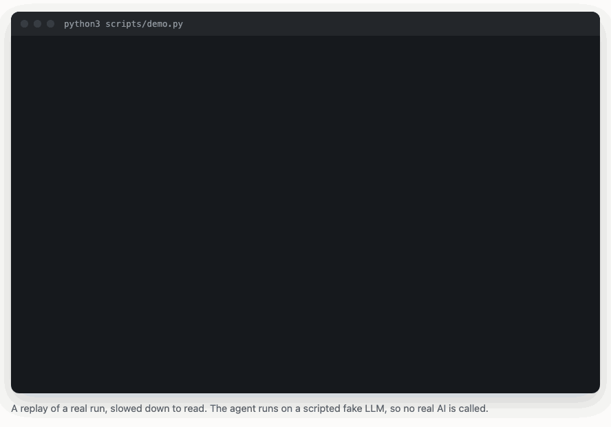

# LivingCode



*A replay of a real run of `scripts/demo.py`, slowed down to read. The agent runs on a scripted fake LLM, so no real AI is called.*

**Site:** https://abozaralizadeh.github.io/LivingCode/

LivingCode lets a project improve itself while it runs on its server. You install it, turn it on with a feature flag, and give it your own LLM API key. A config file says what it may do, such as fixing bugs it finds in the logs.

The AI part never deploys anything itself. It hands its change to a separate guard, and the guard has no AI in it at all. The guard checks the change, makes a backup, deploys it, watches it, and rolls it back on its own if something goes wrong. A rollback needs no network, no LLM and no key.

"LivingCode" is a working name.

## Status: a lab, not a product

Don't point this at a real project yet. Today it only runs on the throwaway sample app in this repo, on macOS. A hardcoded lab lock in `src/livingcode/common/lab.py` refuses any other project, any other machine and any real LLM host. The one exception is the web demo's sealed runner, below.

Nothing in the lab makes a paid or outside call. These are local stand-ins:

| Real thing | Stand-in in the lab | Real adapter |
| --- | --- | --- |
| Claude and ChatGPT | A scripted fake LLM | Written, tested only against a local fake server |
| PyPI | A local folder and a JSON file | Written, tested only against a local fake server |
| pip-audit, bandit | A local advisory file and a small built-in scanner | Written, checked only with a fake command runner |
| git and a remote | Plain folders | Written, checked only with a fake command runner |
| systemd and its sandbox | A local process manager and macOS `sandbox-exec` | Written, checked only with a fake command runner |

What's missing before anyone should use it for real:

- The guard and the agent running as separate operating system users. That split is the main protection in the design, and it needs Linux to test.
- A run of the Linux part of `setup_service.sh`. It has never been run.
- A try with a real LLM, a real project and a real server.
- A privacy review and an outside security review.

## Quick install

You need macOS and Python 3.11 or newer. There are no other dependencies.

```bash
git clone https://github.com/abozaralizadeh/LivingCode.git
cd LivingCode
./setup_service.sh
```

That writes the lab config to `lab/etc/sample.toml`, installs the sample app, starts it and runs `livingcode doctor`, which ends with a practice rollback. Run it again any time to update and restart everything.

Then try a few commands:

```bash
PYTHONPATH=src python3 -m livingcode status
PYTHONPATH=src python3 -m livingcode history
PYTHONPATH=src python3 -m livingcode lab stop
```

To see the whole thing work once, on a fresh temp lab, in a few seconds:

```bash
python3 scripts/demo.py
```

It shows a visitor hitting a bug, the agent writing a fix and a test, a person approving it, a broken version rolled back on its own, and a rollback with the network blocked. Output from a real run is in [docs/demo-output.txt](docs/demo-output.txt). To refresh the replay on the site and the GIF above, run `python3 scripts/record_demo.py` and then `node scripts/make_demo_gif.mjs`, which needs Playwright with Chromium and ffmpeg.

Logs go to `lab/var/log`, and each file there is size limited.

## Web demo

There's also a small web page where a visitor picks one of three planted bugs and watches the agent fix it, with a real AI when an Azure OpenAI key is set. Each run happens in a sealed systemd unit with no network and no key, it's thrown away after, and there are daily caps on runs and tokens. To try it on a Mac:

```bash
PYTHONPATH=src python3 -m livingcode.webdemo.front
```

Then open http://127.0.0.1:8606/. Without a key it runs on the scripted fake AI. How it's locked down and how to host it on a shared Linux VM behind nginx are in [docs/WEB-DEMO.md](docs/WEB-DEMO.md).

On the VM, each run's `livingcode doctor` prints a WARN that the separate guard and agent users aren't in place. That's expected there. Both units run as the folder's owner, so the demo shows the whole flow but not the two user split, which still needs a real Linux install (D23).

## Run the tests

```bash
python3 -m unittest discover -s tests -t .
```

The full run takes a few minutes, because many tests start and stop the sample app for real. Add `-W ignore::ResourceWarning` for quieter output.

## Docs

| Document | What's in it |
| --- | --- |
| [docs/DESIGN.md](docs/DESIGN.md) | Architecture, the reason for each decision, and how the lab build differs from the design |
| [docs/LOGICAL-FLOW.md](docs/LOGICAL-FLOW.md) | The main flows, step by step, with diagrams |
| [docs/OPERATOR.md](docs/OPERATOR.md) | Setting up and running the lab, the commands, and what to do when something goes wrong |
| [docs/WEB-DEMO.md](docs/WEB-DEMO.md) | The web demo: how it's put together, how it's locked down, and how to host it |
| [docs/ROADMAP.md](docs/ROADMAP.md) | The phases, where things stand, and the biggest risks |

## Contributing

Issues and ideas are welcome, and so are changes. Please read [CONTRIBUTING.md](CONTRIBUTING.md) first. It has the one rule that matters most here: nothing may weaken the safety net. It also says how contributions are licensed.

## License

Source available, free for non-commercial use ([PolyForm Noncommercial 1.0.0](LICENSE)). You can use it, study it and change it for anything that isn't commercial. The docs and the demo media are under [CC BY-NC 4.0](LICENSE-DOCS.md).

Commercial use needs written permission. Ask for it by [opening an issue](https://github.com/abozaralizadeh/LivingCode/issues).

Copyright (c) 2026 Abozar Alizadeh.
