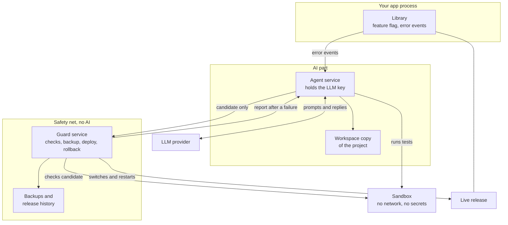

# Design

Everything here is Proposed, which means it's the current plan but can still change. The D numbers below are used across all the docs. The phases are in [ROADMAP.md](ROADMAP.md).

## Architecture

The idea has one hard requirement: the safety net isn't AI. A library inside the app can't meet it alone, because a version that won't start takes the library down too. So there are three running parts, plus a throwaway sandbox.



| Part | Runs as | Can write to | Can't do |
| --- | --- | --- | --- |
| Library | Inside your app | A size-limited event file | Change code, call the LLM, or throw errors into your app |
| Agent | User `lc-agent` | Its workspace, its database, the candidate drop folder | Touch the live release, config, guard, or backups |
| Guard | User `lc-guard` | Releases, backups, its database, report folder | Call an LLM. It has no client and no key |
| Sandbox | Throwaway unit, created per run | A temporary folder that's deleted after | Reach the network or read secrets |

The agent works on the live server, as the idea says, but in a copy. Nothing it does reaches users until the guard accepts it. The agent also runs with CPU and memory limits, so a long round can't slow down the real app.

## Tech stack

| Area | Choice (Proposed) | Reason |
| --- | --- | --- |
| Language | Python 3.11+ | Named in the idea, and has a large pool of web projects to test on |
| Target | One Linux server, app run by systemd | Simple enough to make rollback really reliable |
| Guard dependencies | Python standard library only | Nothing for a package update to break |
| Agent dependencies | Official Anthropic and OpenAI client libraries | Thin, maintained, and cover the two providers named in the idea |
| Config format | TOML | Python 3.11 reads it without extra packages, so the guard can too |
| State | SQLite, one file for the agent and one for the guard | No server to run, and each side owns its own file |
| Sandbox | systemd transient units with no network and a read-only system | Already on the target server |
| Code checks | bandit and pip-audit, in their own tool environment | Fixed checks that give the same result every time |
| Tests | pytest, including a test app with planted bugs | Standard, and lets failures be injected on purpose |

## Key decisions

All of these are Proposed. "Q" names the open question from the original idea that the decision answers.

### D1. A library plus two small services

**Choice:** the package installs the in-app library, the agent service, and the guard service.

**Reason:** the safety net has to survive the app being broken, so it can't live in the app's process. This does stretch the word "library", so it's the first decision on the list.

### D2. Python first, on one Linux server (Q: which language first)

**Choice:** Python web apps run by systemd on a single server. Containers, multiple servers and other languages come later.

**Reason:** fewer deployment styles means a rollback that can be fully tested.

### D3. The operating system enforces the split (Q: how the agent is kept away from the rollback)

**Choice:** separate users and file permissions. Guard code, config and backups aren't writable by the agent. The guard also lives in its own Python environment, away from the app's environment and the agent's.

**Reason:** a rule written in a prompt can be ignored. A file permission can't. Installing the guard from a pinned version also means no agent change can reach it.

### D4. Config lives outside the project

**Choice:** `/etc/livingcode/<app>.toml`, owned by root and only readable by the agent and the guard.

**Reason:** if the config sat in the project, the agent could change what it's allowed to do.

### D5. The feature flag is one config value

**Choice:** `enabled`, false by default. All three parts check it. Off means the library does nothing, the agent starts no rounds, and the guard refuses candidates.

**Reason:** one switch that's easy to find and that the agent can't touch.

### D6. Numbered releases and an atomic switch

**Choice:** each version gets its own folder and its own Python environment. A `current` link points to the live one. Data lives in a shared folder outside the releases.

**Reason:** switching a link is instant and the old folder stays intact. A dependency update is undone along with the code.

### D7. What counts as a failed deploy (Q: what is a failure)

**Choice:** a deploy fails if any fixed check fails.

Before the switch, the guard rejects a candidate that fails any of these:

1. The flag is on and the circuit breaker is closed.
2. It's built on the current live release.
3. It doesn't touch a protected path.
4. It stays within the size limit (Proposed: 20 files, 500 changed lines).
5. It adds no new dependency, unless that capability allows it.
6. bandit and pip-audit find no new high severity problem.
7. All tests pass in the sandbox. Existing tests can't be edited or deleted, only added to.

After the switch, a failure is any of these:

1. The service doesn't reach active within 60 seconds.
2. The health URL doesn't answer OK 5 times in a row within 60 seconds.
3. A smoke check from the config fails.
4. During a 15 minute probation, errors run above 3 times the normal rate, with at least 5 errors.

**Reason:** the checks are plain code with clear results, so no judgement call is left to the AI.

**Known limit:** a clever change could still fool a health check from inside the app, for example through middleware. Protected paths make this harder but don't rule it out, and checks from outside the server come later.

Protected by default: `.env` files, deployment files, migrations, the health endpoint, auth code, payment code. The operator can add more.

### D8. Three triggers first, with limits (Q: which triggers, how often)

**Choice:** a new kind of error in the logs, a daily schedule, and a manual run. One round at a time, at most 3 rounds a day, at most 1 deploy a day, and a 24 hour wait after a rollback.

**Reason:** a project that changes constantly can't be debugged, and limits cap the cost too. The operator can change the numbers.

### D9. Backups cover code and config, data only on request (Q: what's in the backup)

**Choice:** every deploy keeps the previous release. If the operator sets a `backup_command`, it runs too, for example a database dump. The guard keeps the last 5. A failed backup stops the deploy.

A rollback restores code only. A data restore is always a manual step.

**Reason:** restoring a database automatically would erase whatever real users did since the backup.

### D10. The agent can't change the database structure

**Choice:** migrations are protected, so a change that needs one is refused in `auto` mode and left for the operator.

**Reason:** code can be rolled back in seconds, but a changed database can't always be.

### D11. Problems that show up later (Q: what if it's bad later)

**Choice:** after probation, a release counts as settled. A new error after that goes through the normal trigger and gets fixed forward. The operator can go back with `livingcode rollback` at any time, to any of the last 5 releases.

**Reason:** an old release may no longer fit the data, so going back automatically after probation is too risky.

### D12. Reports, retries and the circuit breaker (Q: what the agent does with a report)

**Choice:** the guard writes a report with the failed check and the relevant logs. The agent reads it in a later round and can try the same issue once more. After 2 failed attempts, the issue is marked as needing a person. After 3 rollbacks in a row on any issues, the guard opens the circuit breaker and refuses all candidates until the operator runs `livingcode resume`.

**Reason:** this stops the project from looping through bad fixes. The breaker is in the guard, so the agent can't reset it.

### D13. Two modes per capability (Q: does a person approve)

**Choice:** `propose` means the agent prepares a change and it waits for `livingcode approve`. `auto` means it deploys without waiting. The config template starts every capability on `propose`, and the operator opts in to `auto`. Adding new features stays on `propose` until the project has a track record.

**Reason:** the goal is a project that evolves by itself, but people should earn their way to that on their own project. The guard's checks apply in both modes.

### D14. Behaviour watching is minimal and off by default (Q: users' privacy)

**Choice:** the library records route, status, duration, and a random session value that changes daily. It never records IP addresses, request bodies, typed text, or account details. Only totals reach the LLM, and changes from this capability stay on `propose`.

**Reason:** this is the most sensitive capability legally, and totals are enough for questions like "which page do people leave?".

### D15. Git stays the source of truth (Q: staying in sync)

**Choice:** each deployed release is a commit on a `livingcode/live` branch. After it settles, the guard pushes that branch, and the operator merges it when they want. Human changes go through `livingcode deploy <ref>`, using the same backup and rollback path. A candidate built on an old release gets rejected and the agent starts again.

**Reason:** a live server that quietly differs from the repository would get overwritten by the next normal deploy. The first version only keeps a local repository, and pushing comes in phase 4.

### D16. Hard budget limits (Q: LLM costs)

**Choice:** a limit per round and per month, both in the config. The monthly default is 20 US dollars. At the limit, the agent stops and tells the operator. The agent counts usage from what each API reply reports.

**Reason:** a bug in a loop shouldn't turn into a surprise bill.

### D17. Treat logs and user data as hostile

**Choice:** anything from logs or users goes to the LLM marked as data, never as instructions. Secrets and personal details like emails and tokens are removed by fixed rules before anything is sent. Sensitive files are never sent. The agent has no shell, only a short list of tools: read, search, edit, run tests.

**Reason:** attackers can write text into your logs just by sending a bad request. Marking it as data helps but can't fully stop prompt injection, which is why protected paths, the sandbox, and the guard's checks all stay in place whatever the agent believes.

### D18. A small provider layer

**Choice:** one small internal interface with an adapter for each LLM provider. The operator picks provider and model in the config. The key stays in a file only `lc-agent` can read.

**Reason:** this gives the "bring your own key" part without tying the design to one vendor. Model names stay in config because they change often.

### D19. The guard stays tiny

**Choice:** standard library only, no plugins, and a size target of under 2,000 lines. External tools run as separate commands.

**Reason:** the code you trust most should be the code you can read in an afternoon.

### D20. Command line first, no web dashboard

**Choice:** everything runs through commands, and alerts go to a webhook you set.

**Reason:** a dashboard adds a login and one more thing to secure on a live server. A webhook works with Slack, Discord, ntfy and others.

### D21. Source available, free for non-commercial use

**Choice:** publish the source under PolyForm Noncommercial 1.0.0, with the docs and demo media under CC BY-NC 4.0. Commercial use needs written permission.

**Reason:** people need to read the code before they let it change their live server. The licence also has a clear no-liability clause, which matters for a tool like this.

### D22. The app holds a lock file while it runs

**Choice:** when the guard starts the app itself (the `local` runner), it hands the app a locked file. The app counts as running for as long as that lock is held. With the `systemd` runner, the guard asks systemd instead.

**Reason:** the first lab build looked for the app in the process list with `ps`. On macOS `ps` is a setuid program, and the no-network sandbox refuses to run those, so a rollback under that sandbox couldn't tell if the app was up and ended in NeedsHuman. A lock needs no outside program and no network, the operating system drops it the moment the app dies, even after `kill -9`, and a reused process id can't fool it.

## Data model

Each side owns its own database. They exchange information through files in two folders, so neither reads the other's database.

### Guard database

| Table | Main fields |
| --- | --- |
| `release` | id, git commit, source (`agent` or `human`), state, created at, settled at |
| `deployment` | id, candidate id, release id, state, failed check, started at, finished at |
| `backup` | id, release id, path, size, data backup included |
| `breaker` | state, opened at, reason, consecutive rollbacks |
| `audit_log` | time, actor, action, detail. Rows are only ever added |

### Agent database

| Table | Main fields |
| --- | --- |
| `issue` | id, fingerprint, capability, first seen, attempts, status |
| `trigger_event` | id, type, time, issue id, outcome |
| `round` | id, trigger id, issue id, status, summary, started at, finished at |
| `llm_usage` | round id, provider, model, input tokens, output tokens, estimated cost |

### Exchanged files

| File | Written by | Read by | Contents |
| --- | --- | --- | --- |
| Candidate | Agent | Guard | Patch, base release, capability, mode, issue id, plain summary of the change |
| Report | Guard | Agent | Deployment id, failed check, log excerpt, what the guard did |
| Event file | Library | Agent | Error fingerprints, and behaviour totals if enabled. Size limited |

### Files on disk

| Path | Purpose |
| --- | --- |
| `/etc/livingcode/<app>.toml` | Config, root owned |
| `/etc/livingcode/<app>.agent.env` | LLM key, readable only by `lc-agent` |
| `/opt/<app>/releases/<id>/` | One folder per version |
| `/opt/<app>/current` | Link to the live release |
| `/opt/<app>/shared/` | Data that survives releases |
| `/var/lib/livingcode/<app>/` | Databases, candidates, reports, backups, each with its own permissions |
| `/var/log/livingcode/` | Logs, limited to 3 files of 10 MB each |

## Config file

This is an example of the shape, not a final format.

```toml
enabled = false

[app]
name = "shop"
service = "shop.service"
repo = "/opt/shop/repo"
log_files = ["/var/log/shop/app.log"]

[llm]
provider = "anthropic"
model = "set-your-model-here"
budget_per_round_usd = 2
budget_per_month_usd = 20

[capabilities]
bug_fixing = "propose"
updating = "off"
fixing_vulnerabilities = "off"
watching_user_behaviour = "off"
adding_features = "off"

[limits]
rounds_per_day = 3
deploys_per_day = 1
max_changed_files = 20
max_changed_lines = 500

[health]
url = "http://127.0.0.1:8000/health"
probation_minutes = 15
smoke_checks = [
  { url = "http://127.0.0.1:8000/", expect_status = 200 },
]

[safety]
protected_paths = ["migrations/", "deploy/", "app/auth/", "app/payments/"]
backup_command = ""
alert_webhook = ""
```

Each capability from the idea can be `off`, `propose` or `auto`.

| Capability | What it does | First available |
| --- | --- | --- |
| Bug fixing | Reads logs, finds errors, fixes the code | v0.1 |
| Updating | Moves dependencies to newer versions after a 7 day wait | v0.2 |
| Fixing vulnerabilities | Acts on pip-audit findings | v0.2 |
| Watching user behaviour | Uses behaviour totals to update the code | v0.3 |
| Adding new features | Builds a feature described by the operator, or one it suggests | v0.4 |

## Commands

There are no screens in the first version. Everything uses the `livingcode` command.

| Command | What it does |
| --- | --- |
| `livingcode init` | Asks a few questions and writes the config |
| `sudo livingcode install` | Creates users, folders and services |
| `livingcode doctor` | Checks the setup, including a test of the rollback |
| `sudo livingcode on` / `off` | Sets the feature flag |
| `livingcode status` | Shows the flag, live release, breaker, budget used |
| `livingcode run` | Starts a round now |
| `livingcode proposals` | Lists changes waiting for approval |
| `livingcode show <id>` | Shows the change, the reason, and the check results |
| `livingcode approve <id>` / `reject <id>` | Decides on a proposal |
| `livingcode deploy <ref>` | Deploys a human change through the same safe path |
| `livingcode history` | Lists releases and rollbacks |
| `livingcode rollback [release]` | Goes back by hand, to the previous or a named release |
| `sudo livingcode resume` | Closes the circuit breaker after a person has looked at it |
| `livingcode cost` | Shows LLM spending |

The commands that change the live release or the safety state talk to the guard and need the operator's rights. The agent user can't run them.

## How the lab build differs from this design

The lab build follows this design, with these differences. Each one is either to keep the project free of outside dependencies for now, or because the lab runs on a Mac.

| Design says | Lab build does | Why |
| --- | --- | --- |
| Official client libraries for Claude and ChatGPT | Plain HTTP calls with the standard library | Keeps the project free of outside dependencies for now. Tested only against a local fake server |
| pytest | `unittest` | Same reason, it's in the standard library |
| A candidate is a patch | A candidate is a JSON list of whole file changes, each with the hash of the file it replaces | Simpler to check and nothing to apply with an outside tool |
| A virtual environment per release | A `_deps` folder per release, installed from a hashed lock file and a local package folder | No network, and no wheels to download |
| git and a remote branch | Plain folders (`LocalHistory`). A git version is written, but only checked with a fake command runner | The lab has no remote repository |
| pip-audit and bandit | A local advisory file and a small built-in scanner. Adapters for both are written, but only checked with a fake command runner | Neither is a dependency yet |
| systemd, its sandbox, and separate users | A local process manager (D22), `sandbox-exec`, and one user | The lab runs on a Mac |
| `init` asks questions | `init` writes the lab config straight away | Only the sample app is allowed |
| `on`, `off` and `resume` need sudo | They don't, in the lab | One user on the Mac |
| Commands listed above | Also `guard-service`, `agent-service` and `lab stop`, `lab restart`, `lab reset` | To run the two services and look after the sample app |
| Behaviour totals (D14) | The guard's own health and smoke checks identify themselves and aren't counted | They aren't visits |

On top of all this, a hardcoded lab lock (`src/livingcode/common/lab.py`) only allows the throwaway sample app on this Mac, with the health URL, webhook and LLM all on this machine, and no git push.
