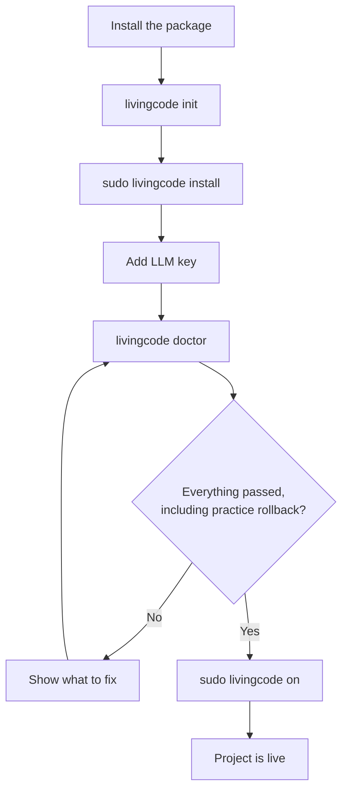
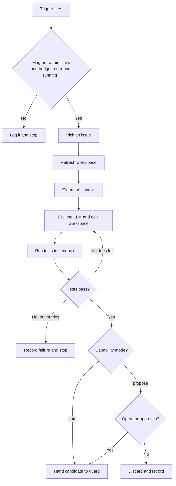
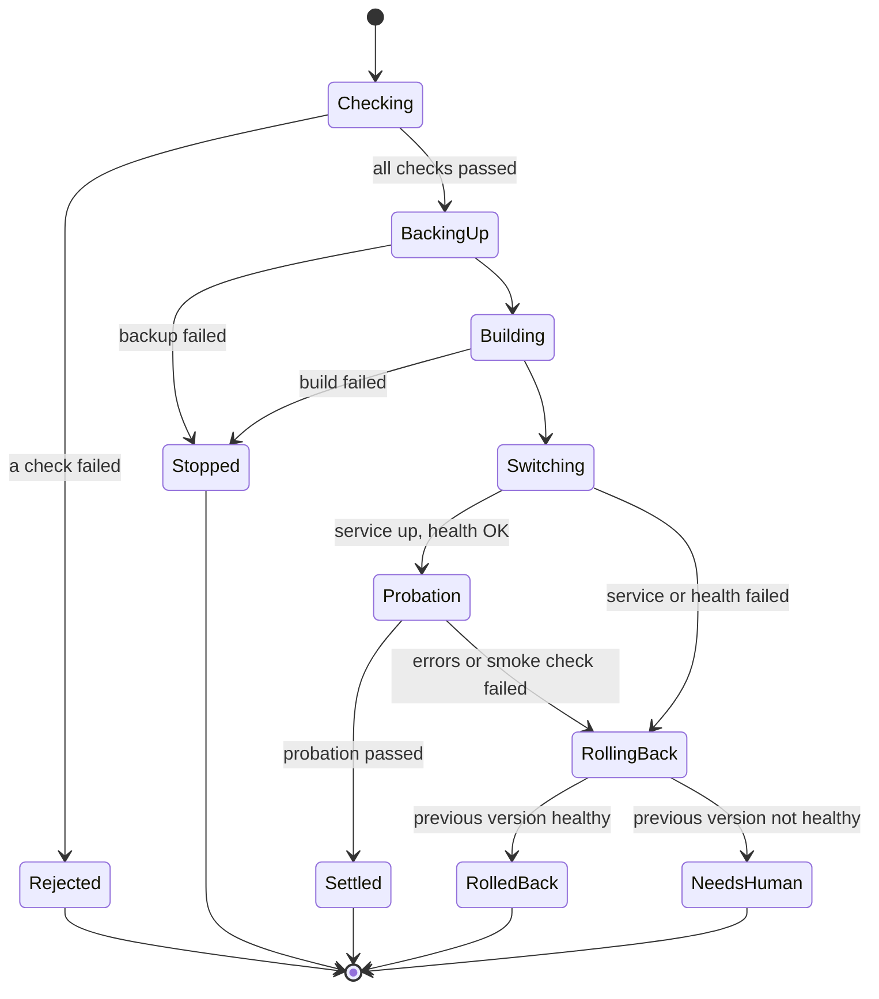
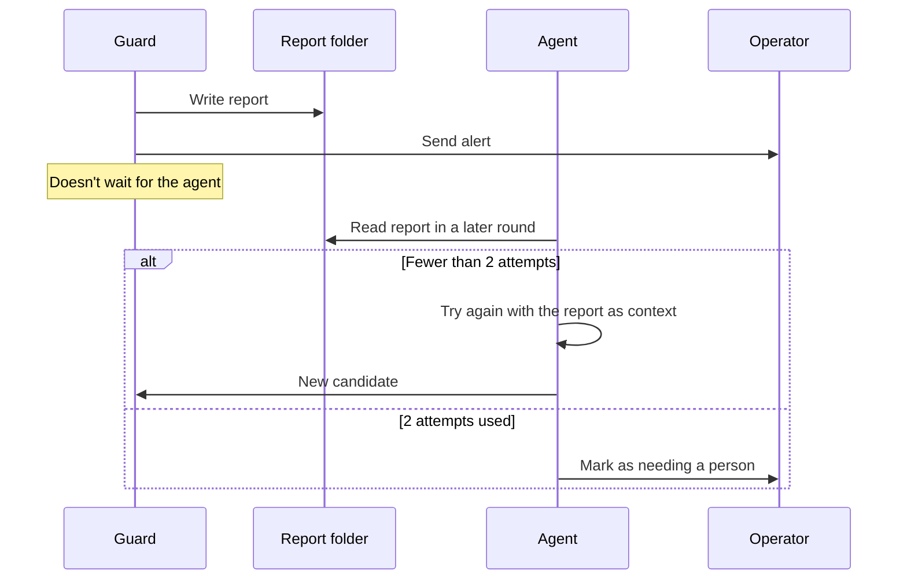
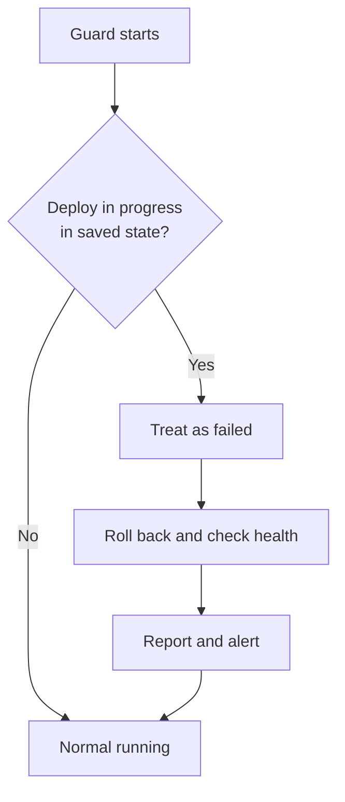
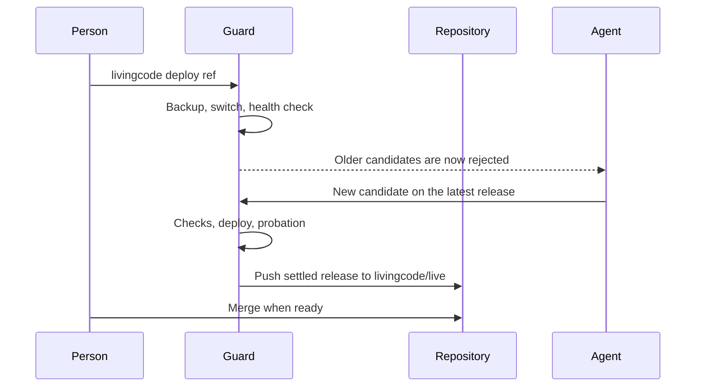

# Logical flow

These are the main flows, following [DESIGN.md](DESIGN.md). All of it is Proposed and can still change. Numbers such as limits and timeouts are defaults from the config.

## 1. Install and turn on

1. The operator installs the package into the project.
2. `livingcode init` writes the config, with the flag off and every capability on `propose` or `off`.
3. `sudo livingcode install` creates the users, folders and services.
4. The operator adds their LLM key.
5. `livingcode doctor` checks the setup and runs a practice rollback.
6. `sudo livingcode on` turns on the flag, but only if the doctor passed.

## 2. Improvement round

1. A trigger fires: a new error, the daily schedule, or `livingcode run`.
2. The agent checks the flag, the limits, the budget, and that no other round is running.
3. It picks the most useful issue among the capabilities that are switched on.
4. It refreshes its workspace from the current release.
5. It removes secrets and personal details from the context, then calls the LLM.
6. It edits the workspace and runs the tests in the sandbox, repeating up to 5 times.
7. If the tests pass, it creates a candidate.
8. In `auto` mode, the candidate goes straight to the guard. In `propose` mode, it waits for the operator's approval.
9. If it can't get the tests to pass, it records why and stops. Nothing changes on the live system.

## 3. Deploy and rollback

The guard runs this flow alone. No step here uses AI.

1. The guard runs the fixed checks on the candidate (see D7). Any failure means it's rejected, and users never see it.
2. It makes the backup. If the backup fails, the deploy stops.
3. It builds the new release folder and its environment.
4. It records the state, switches the `current` link, and restarts the service.
5. It runs health and smoke checks, then watches the 15 minute probation.
6. If everything passes, the release is settled.
7. If anything fails, it switches the link back, restarts the service, and checks health again.
8. It writes a report, adds to the audit log, and alerts the operator.
9. If the rollback itself fails, it opens the breaker and sends an urgent alert. Only a person can continue from there.

## 4. Report and retry

1. After a rejection or rollback, the guard writes a report. It doesn't wait for the agent.
2. If this makes 3 rollbacks in a row, the guard opens the breaker.
3. The agent reads the report in a later round, after the 24 hour wait when it was a rollback.
4. If the issue has had fewer than 2 attempts, the agent tries again with the report as context.
5. Otherwise, it marks the issue as needing a person and alerts the operator.

## 5. Stopping it

There are three ways to stop it, from gentle to forced.

| Way to stop | What happens |
| --- | --- |
| Flag off | No new rounds start and candidates are refused. A deploy already in probation finishes its checks, so the safety net stays active |
| Circuit breaker open | The guard refuses candidates until `livingcode resume`. It opens by itself after 3 rollbacks in a row |
| Manual rollback | `livingcode rollback` goes back to an earlier release at any time |

Removing the package doesn't touch the live release. The app keeps running on its current version.

## 6. Guard crash or server restart

A deploy may be cut off halfway. The guard starts with the system and picks up from its saved state.

1. On start, the guard reads its last recorded deployment.
2. If nothing was in progress, it carries on as normal.
3. If a deploy was in progress and the release hadn't passed its checks, it treats that as failed and rolls back.
4. It writes a report and alerts the operator.

## 7. Human change and git sync

This flow arrives in phase 4. Until then, the repository stays local.

1. A person deploys with `livingcode deploy <ref>`.
2. The guard applies the same backup, switch, health and rollback path. It skips the limits made for the agent, such as size and protected paths.
3. Any waiting candidate built on the old release is rejected, and the agent starts again.
4. After an agent release settles, the guard pushes it to the `livingcode/live` branch.
5. The operator merges that branch when they want.

